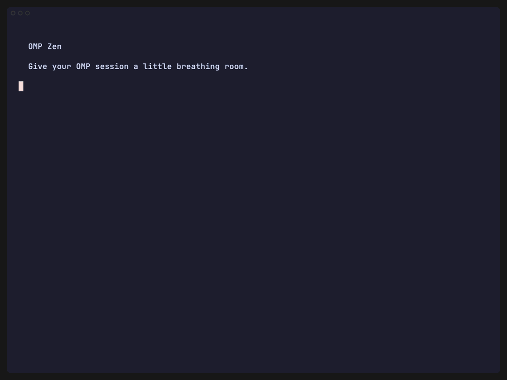

# OMP Zen

> Give your OMP session a little breathing room.

Quiet tool calls for [Oh My Pi](https://omp.sh). Same tools. Details one keypress away.



## Quickstart

1. Install **OMP 18.8.7** and connect your model: [setup](docs/SETUP.md).
2. Open a terminal in the `omp-zen` folder you received.
3. Run:

```sh
omp --extension .
```

Ask OMP to list files. Press **Ctrl+O** to expand or collapse results.

No build or config editing. Not published yet.

[Setup](docs/SETUP.md) · [Coverage](docs/COVERAGE.md) · [Contributing](CONTRIBUTING.md) · [MIT](LICENSE)
